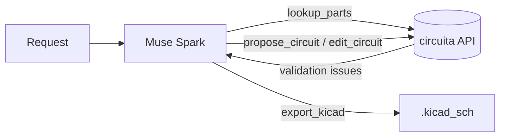

# circuita-agent

An agent that designs electronic circuits with Meta's **Muse Spark** and checks every design
with a deterministic validator, repairing its own mistakes until the circuit is valid.

You describe a circuit ("an ESP32 that reads a potentiometer and blinks an LED"). The model does
not just write a netlist and hope: it calls tools, the validator reports exactly what is wrong
(a floating required pin, an LED wired backwards, a regulator output shorted), and the model
fixes it. When the design has zero errors it can be exported to a real KiCad `.kicad_sch` file.



## What is new in this repository, and what is not

This project is a continuation of work that existed before the Meta Global AI Developer
Hackathon (which started on 2026-10-26). To keep that boundary clear:

**Existed before the hackathon (not in this repository).** *circuita*, a private product that
turns a natural-language description into a validated, laid-out circuit and exports it to
KiCad. It has a FastAPI backend (compiler, electrical validator, component library with real
pinouts, layout engine, KiCad exporter) and a web interface, and it used Gemini as its language
model. It runs as a hosted service and this repository only calls its HTTP API.

**Written during the hackathon, in this repository (everything here):**
- the agent loop and its repair logic (`agent.py`),
- the tool definitions the model sees and the runner that executes them (`tools.py`),
- the HTTP client for the circuita API (`circuita_client.py`),
- the integration with Meta's Model API (`model.py`) and the prompts (`prompts.py`),
- the benchmark that compares one-shot generation with the repair loop (`benchmark.py`),
- the command line (`cli.py`) and the test suite (`tests/`).

**Changed in circuita during the hackathon (code lives in the private repository):** an API-key
guard with a switch that disables every route calling a language model, a read-only
`GET /parts` endpoint that exposes the known parts with their real pinouts, and Docker
packaging so the API can be hosted.

Open-source dependencies: the `openai` SDK (used only as an HTTP client for Meta's
OpenAI-compatible endpoint) and `httpx`.

## How it works

Four tools are exposed to the model:

| Tool | What it does |
|---|---|
| `lookup_parts` | Lists known parts, or returns one part's exact value string and real pin numbers and names |
| `propose_circuit` | Creates a design from components and nets; returns resolved pins and validation issues |
| `edit_circuit` | Applies atomic edit operations to a design; returns the new issues |
| `export_kicad` | Exports a design with no errors to a `.kicad_sch` file |

The loop (`agent.py`) runs until the design has no validation errors, the model stops, or the
turn limit is reached. If the model stops while errors remain, it is told once exactly which
ones and asked to fix them. Tool failures never crash the loop: they are returned to the model
as an error message it can act on.

The benchmark (`benchmark.py`, 20 circuits in `benchmarks/circuits.json`) solves each circuit
twice with the same model and prompt: **single** (one proposal, no feedback) and **agent** (the
repair loop). A circuit passes when it compiles, the validator finds zero errors, and the
expected component categories are present. It stops by itself when the estimated cost reaches
`--max-cost-usd`.

## Setup

Requires Python 3.12+ and a running circuita API.

```bash
python3 -m venv .venv && source .venv/bin/activate
pip install -e ".[dev]"
cp .env.example .env        # then fill in MODEL_API_KEY (never commit .env)
python -m circuita_agent check
```

```bash
python -m circuita_agent run "An ESP32 reading a potentiometer on GPIO34 and blinking an LED"
python -m circuita_agent run "..." --mode single      # baseline, no repair loop
python -m circuita_agent run "..." --export-dir out   # lets the agent export KiCad
python -m circuita_agent benchmark --max-cost-usd 1.0
```

## Tests

The whole suite runs without network access and without calling any model: a fake circuita API
and a scripted model stand in for the real ones.

```bash
ruff check src tests && mypy src && pytest -q
```

## Benchmark results

_To be filled in with real runs._

## License

MIT
